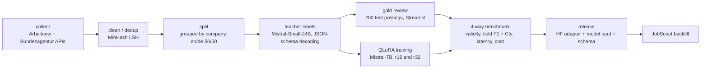

# JobLens Extract

**Can a small fine-tuned open-weight model replace a large model for structured extraction, and what is gained or lost in quality, latency and cost?**

JobLens turns German and English job postings into a validated 17-field JSON record (remote policy, seniority, skills, language requirements, contract, salary, visa/relocation, deadline…). It benchmarks four systems against 200 hand-checked postings:

| | System |
|---|---|
| (a) | Mistral-7B-Instruct-v0.3, zero-shot |
| (b) | Mistral-7B-Instruct-v0.3, few-shot |
| (c) | Mistral-7B + QLoRA adapter (this repo; distilled from the teacher) |
| (d) | Mistral-Small-24B-Instruct-2501 open-weight, JSON-schema constrained decoding (stand-in for the Mistral Small API, see [D-001](docs/DECISIONS.md)) |

The fine-tuned adapter also back-fills the JobScout app's database ([contract](docs/HANDOFF_JOBSCOUT.md)).

## Results
Generated by `make eval report` (full tables, CIs, en/de breakdown, latency and cost in [docs/RESULTS.md](docs/RESULTS.md); cost scenarios in [docs/COSTS.md](docs/COSTS.md)). "not measured" = the Kaggle runs and gold labels are still pending.

<!-- BEGIN GENERATED -->
Test postings with gold labels: **not measured**

| System | json_parse_rate | schema_valid_rate | micro_f1 | macro_f1 | enum_accuracy | salary_accuracy | skills_f1 | micro-F1 95% CI |
|---|---|---|---|---|---|---|---|---|
| (a) Mistral-7B base, zero-shot | not measured | not measured | not measured | not measured | not measured | not measured | not measured | not measured |
| (b) Mistral-7B base, few-shot | not measured | not measured | not measured | not measured | not measured | not measured | not measured | not measured |
| (c) Mistral-7B + QLoRA adapter | not measured | not measured | not measured | not measured | not measured | not measured | not measured | not measured |
| (d) Mistral-Small-24B open-weight, JSON-schema decoding | not measured | not measured | not measured | not measured | not measured | not measured | not measured | not measured |
| teacher labels (after re-ask) | not measured | not measured | not measured | not measured | not measured | not measured | not measured | not measured |
<!-- END GENERATED -->

## Pipeline



## Reproduce

**Local (no GPU needed):**
```bash
make setup                 # uv venv with pinned deps, project-local gitleaks, git hook
make collect data          # fetch ~6,600 postings politely, clean, dedup, token stats, split
make kaggle-bundle         # private Kaggle dataset + notebooks in kaggle_upload/ (git-ignored)
make test lint gitleaks    # tests (coverage ≥ 80% on src/), ruff, mypy --strict, secret scan
```

**Kaggle (free GPU T4 x2):** follow [KAGGLE_STEPS.md](KAGGLE_STEPS.md). Notebooks 00 teacher labels → 01 QLoRA training → 02 benchmark → (03 batching + GGUF) → (04 back-fill).

**Back on the laptop:**
```bash
make import-artifacts      # validate + import Kaggle outputs
make review                # hand-check the 200 test postings (Streamlit)
make gold eval costs report card
make publish-hf            # optional; shows the files and asks for confirmation
```

Every number in the docs comes from one of these targets. Coverage excludes Kaggle-only GPU code (`src/joblens/kaggle/`) and the Streamlit UI ([D-012](docs/DECISIONS.md)).

## Data and licences
Data: [Arbeitnow](https://www.arbeitnow.com) Job Board API and the Bundesagentur für Arbeit Jobsuche API (unofficial docs: [bund.dev](https://jobsuche.api.bund.dev/)). Terms: [docs/DATA_SOURCES.md](docs/DATA_SOURCES.md). **Posting texts are never committed or published**, only IDs/URLs, labels and the schema. Code: MIT ([LICENSE](LICENSE)). Docs and model-card text: CC-BY-4.0. Adapter weights: CC-BY-NC-4.0, because the data terms allow only non-commercial use ([D-019](docs/DECISIONS.md)). Base model and teacher: Apache-2.0.

## Limitations
- **Distillation ceiling:** the adapter learns from the teacher, so it can inherit the teacher's mistakes.
- **Gold-label anchoring:** I reviewed the test labels starting from the teacher's suggestions, which can favour teacher-like systems.
- **Small test set:** 200 postings give wide confidence intervals.
- **Coverage of jobs:** collection is tech-heavy, and postings outside Germany are out of scope.
- **Not a production service:** this is a batch pipeline and a benchmark, not a deployed API.

## Links
- GitHub: https://github.com/srghosh56/joblens-extract
- Hugging Face adapter: https://huggingface.co/gmohor21/joblens-mistral-7b-lora

## Docs
[DECISIONS](docs/DECISIONS.md) · [LABELING_GUIDE](docs/LABELING_GUIDE.md) · [RESULTS](docs/RESULTS.md) · [ERROR_ANALYSIS](docs/ERROR_ANALYSIS.md) · [COSTS](docs/COSTS.md) · [MODEL_CARD](docs/MODEL_CARD.md)
