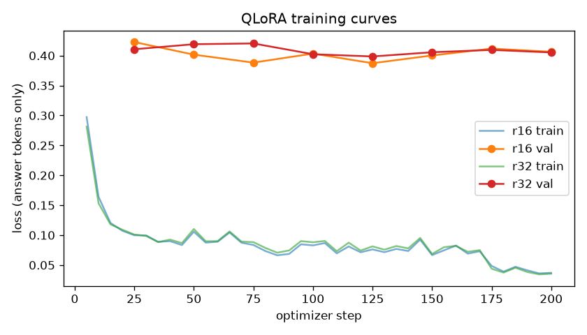

# Results (v1)

The tables between the markers below are generated by `make eval costs report`; the discussion after them was written once the numbers were final. Three measurements are missing from v1 and appear as "not measured": the throughput of the fine-tuned model on vLLM and the CPU (GGUF) run, both planned for v1.1, and the batched throughput of system (b), which ran out of GPU memory.

**Question:** Can a small fine-tuned open-weight model replace a large model for extracting structured fields from German and English job postings, and what changes in quality, speed and cost?

**Systems compared**

| | System | What it shows |
|---|---|---|
| (a) | Mistral-7B-Instruct, instructions only (zero-shot) | the small model with no help |
| (b) | Mistral-7B-Instruct, instructions plus two worked examples (few-shot) | whether prompting alone is enough |
| (c) | Mistral-7B-Instruct + QLoRA adapter trained on the teacher's labels | the effect of fine-tuning |
| (d) | Mistral-Small-24B-Instruct (the teacher), JSON-schema constrained decoding, first answer only | the large model, as a stand-in for the Mistral Small API ([D-001](DECISIONS.md)) |
| teacher labels | the same 24B model's labels after one retry on invalid output | the data system (c) was trained on |

All five use the same instructions. (c) is the candidate replacement; (d) is what it would replace.

**Reading the tables**
- Every quality number compares a system's output with the 200 gold labels of the test set. No employer in the test set appears in the training data. The gold-label method is described in [GOLD_LABELLING.md](GOLD_LABELLING.md).
- Ranges in brackets are 95% bootstrap confidence intervals. The 200 test postings were resampled with replacement 1,000 times, each resample was scored again, and the interval covers the middle 95% of those scores. A narrow interval means the score would change little on a different sample of postings.
- Differences between two systems use a paired bootstrap: in each resample both systems are scored on the same postings and their difference is recorded. A difference is treated as real when its 95% interval does not include zero (`artifacts/results/eval_summary.json`, key `paired_micro_f1`).
- Known bias: the gold labels were produced by correcting the teacher's labels, and a teacher answer was kept whenever it was acceptable. This favours the teacher and system (d), so the true gap between (c) and (d) is, if anything, slightly smaller than reported.

<!-- BEGIN GENERATED -->
### Data
- Postings after cleaning: 6598; exact duplicates removed: 153; near duplicates removed (MinHash LSH): 577.
- Posting length (Mistral tokens): p50 1,087, p95 2,043; max input tokens chosen: 2048; postings truncated: 4.9%.
- Split sizes: train 2,700, val 300, test 200.

### Main table (vs. gold)
Test postings with gold labels: **200**

| System | json_parse_rate | schema_valid_rate | micro_f1 | macro_f1 | enum_accuracy | salary_accuracy | skills_f1 | micro-F1 95% CI |
|---|---|---|---|---|---|---|---|---|
| (a) Mistral-7B base, zero-shot | 93.0% | 62.0% | 43.9% | 42.8% | 43.9% | 88.5% | 37.6% | [39.8%, 47.7%] |
| (b) Mistral-7B base, few-shot | 100.0% | 42.0% | 33.1% | 40.8% | 34.4% | 89.0% | 20.5% | [28.3%, 37.4%] |
| (c) Mistral-7B + QLoRA adapter | 98.0% | 97.5% | 62.9% | 73.5% | 91.5% | 97.5% | 49.7% | [59.6%, 66.3%] |
| (d) Mistral-Small-24B open-weight, JSON-schema decoding | 99.0% | 99.0% | 75.1% | 79.6% | 94.2% | 99.0% | 66.8% | [72.2%, 78.0%] |
| teacher labels (after re-ask) | 100.0% | 100.0% | 75.5% | 79.9% | 95.1% | 99.0% | 67.0% | [72.7%, 78.3%] |

### By language
| System | lang | n | micro_f1 | schema_valid_rate | skills_f1 |
|---|---|---|---|---|---|
| a | en | 99 | 46.2% | 69.7% | 40.4% |
| a | de | 101 | 40.8% | 54.5% | 33.9% |
| b | en | 99 | 36.0% | 50.5% | 23.1% |
| b | de | 101 | 29.2% | 33.7% | 16.9% |
| c | en | 99 | 59.4% | 96.0% | 46.5% |
| c | de | 101 | 67.9% | 99.0% | 55.0% |
| d | en | 99 | 73.7% | 99.0% | 66.9% |
| d | de | 101 | 77.0% | 99.0% | 66.6% |

### Per-field F1
| Field | (a) F1 | (b) F1 | (c) F1 | (d) F1 |
|---|---|---|---|---|
| `title` | 52.5% | 49.3% | 73.4% | 72.4% |
| `company` | 58.1% | 56.5% | 80.1% | 87.6% |
| `locations` | 44.2% | 39.6% | 75.0% | 77.8% |
| `remote_policy` | 47.5% | 40.5% | 87.7% | 90.9% |
| `seniority` | 55.8% | 51.0% | 78.9% | 80.7% |
| `min_years_experience` | 73.3% | 63.7% | 96.6% | 98.0% |
| `required_skills` | 37.6% | 20.5% | 49.7% | 66.8% |
| `nice_to_have_skills` | 31.7% | 20.3% | 49.8% | 71.3% |
| `languages_required` | 49.0% | 40.5% | 58.7% | 74.2% |
| `english_sufficient` | 63.3% | 49.3% | 91.5% | 96.9% |
| `contract_type` | 31.1% | 30.8% | 89.2% | 86.3% |
| `contract_duration_months` | 66.7% | 33.3% | 90.9% | 100.0% |
| `salary` | 32.4% | 35.3% | 82.1% | 92.9% |
| `visa_sponsorship` | 0.0% | 80.0% | 66.7% | 66.7% |
| `relocation_support` | 9.3% | 26.1% | 80.0% | 90.9% |
| `application_deadline` | 0.0% | 0.0% | 0.0% | 0.0% |
| `posting_language` | 75.3% | 57.7% | 98.7% | 99.0% |

### Training
| Config | trainable params | best val loss | steps | wall time (h) | peak GPU mem (GB) |
|---|---|---|---|---|---|
| r16 | 41943040 | 0.39 | 200 | 7.75 | 13.59 |
| r32 | 83886080 | 0.40 | 200 | 8.56 | 13.71 |

### Latency
| System | p50 s (bs=1) | p95 s (bs=1) | tokens/s (bs=1) |
|---|---|---|---|
| a | 20.27 | 31.26 | 16.00 |
| b | 20.04 | 29.38 | 9.74 |
| c | 14.61 | 23.13 | 13.96 |
| d | 12.13 | 19.12 | 21.18 |

### Cost per 1,000 postings
| System | Hardware basis | Throughput (postings/s) | USD / 1k self-hosted (estimate) | USD / 1k at Mistral API list price |
|---|---|---|---|---|
| a | AWS g4dn.xlarge (1x NVIDIA T4, 4 vCPU, 16 GiB), EU (Frankfurt), Linux | 0.03 | 6.17 | not measured |
| c | AWS g4dn.xlarge (1x NVIDIA T4, 4 vCPU, 16 GiB), EU (Frankfurt), Linux | 0.04 | 5.14 | not measured |
| d | 2 x AWS g4dn.xlarge (1x NVIDIA T4, 4 vCPU, 16 GiB), EU (Frankfurt), Linux | 0.27 | 1.36 | 0.40 |

Prices read on 2026-11-01; sources in `artifacts/results/costs.json`.
<!-- END GENERATED -->

## Findings

### 1. Fine-tuning works
After QLoRA training, the same 7B model rises from 43.9% to 62.9% micro-F1, a gain of 19.1 points (paired bootstrap 95% CI: +14.3 to +23.3). Most of the gain is in output format: 97.5% of outputs now pass the schema, against 62.0% before, and fixed-choice field accuracy rises from 43.9% to 91.5%.

### 2. The fine-tuned model does not yet replace the 24B model
System (d) scores 75.1%, 12.2 points higher (CI: 8.6 to 15.8 points). The gap is concentrated in the open-ended fields: required skills (49.7% vs 66.8% F1), nice-to-have skills (49.8% vs 71.3%), languages (58.7% vs 74.2%) and company (80.1% vs 87.6%). On fixed-choice and short fields the small model is close or slightly ahead: contract type 89.2% vs 86.3%, title 73.4% vs 72.4%, remote policy 87.7% vs 90.9%, years of experience 96.6% vs 98.0%. Fine-tuning taught the format and the simple fields; long requirement lists remain the larger model's advantage.

### 3. The student copies the teacher's habits, including its errors
The teacher often lists a language that the posting does not ask for: on 70 of the 200 test postings, mostly English. The fine-tuned model makes the same extra entry on 60 of those 70. On English postings it lists English 92 times out of 96, while the gold labels contain it 40 times. Across all its errors, 38% are identical to the teacher's answer, and for some fields the share is much higher: seniority 73%, title 66%, company 63%, languages 60%. This is expected, since the student only ever saw the teacher's labels. The fix belongs in the labels rather than the model: a clearer rule in the labelling prompt followed by a new labelling run, or a post-processing rule that drops any language the posting never mentions.

### 4. Few-shot examples made the base model worse
With two worked examples in the prompt, the base model fell to 33.1% (from 43.9% zero-shot), and only 42% of its outputs passed the schema. Generation was also slower (9.7 against 16.0 tokens per second at batch size 1) because each prompt is much longer. The cause was not investigated; a plausible explanation is that the long examples dilute the posting and the model imitates their structure loosely. For this task, fine-tuning helped far more than prompting.

### 5. A larger adapter did not help
The r32 adapter has twice as many trainable parameters as r16 and trained about 10% longer, but scores 62.0% against 62.9% and has a slightly higher validation loss (0.40 vs 0.39). Both runs stopped early at step 200 of 336 planned steps (patience of three evaluations) and kept the checkpoint from step 125. After that point the training loss kept falling (to about 0.04) while the validation loss rose, a sign of memorising the training labels. The r16 adapter is the released model.

### 6. German postings are easier for the fine-tuned model than English ones
System (c) scores 67.9% on German postings and 59.4% on English ones; the 24B model is more even (77.0% vs 73.7%). Finding 3 explains part of this: 52 of the student's 60 unrequired language entries are on English postings.

### 7. Five of 200 outputs were unusable
In four cases the model repeated the same few skills until it reached the 700-token output limit, so the JSON never closed. In one case it produced the language level "strong", which the schema does not allow. The teacher showed the same unclosed-JSON behaviour on 18 training postings, which were dropped. A repetition penalty or a cap on list length at generation time is the first remedy to test.

### 8. In this setup the small model is not cheaper
Self-hosted on T4 GPUs, the fine-tuned 7B costs about $5.14 per 1,000 postings and the 24B about $1.36. At Mistral's API list price (Mistral Small 4, Mistral's current API model in that size class) the cost would be about $0.40. This comparison mostly reflects the serving software rather than the models: the 24B ran on vLLM, which batches many postings at once across two GPUs, while the 7B ran with plain Hugging Face generation, 8 postings at a time on one GPU. A fair comparison requires the 7B on vLLM as well, planned for v1.1. Until then, the conclusion is that at this volume the hosted API is the cheapest option, and the reasons to self-host the 7B are control and offline use, not price.
